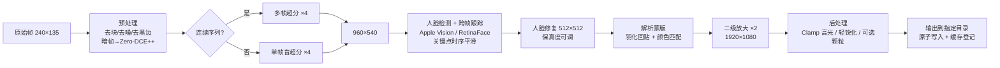

# 低清人物图像序列修复与循环播放工具 — 产品需求文档（PRD）

| 项目 | 内容 |
| --- | --- |
| 文档版本 | v0.3（已确认：Mac、自用、原视频不在、1080p、可导出视频） |
| 日期 | 2026-11-01 |
| 产品代号 | **ReFrame**（暂定） |
| 姊妹项目 | [linlea666/vo](https://github.com/linlea666/vo)（Vo Player，macOS 视频播放 + 画面修复） |
| 状态 | 草案 / 进入 M0 技术验证前 |

### 修订记录

| 版本 | 变更 |
| --- | --- |
| v0.1 | 初稿：问题定义、修复管线、功能需求、质量评估、里程碑 |
| v0.3 | 落实已确认需求：只做 Mac；仅自用，可用非商用许可模型；原视频不在，输入就是现有帧，加强去压缩预处理；输出固定 1080p；**导出视频提升为 P0** 并补充规格（§6.5） |
| v0.2 | ① 平台改为 **macOS（Apple 芯片）优先**，与 vo 同栈；② 新增 §4「vo 技术复用」；③ 新增 §5「市场修复技术调研」；④ 修复管线改为**四档分层**（实时 / 标准 / 高质量 / 极致）；⑤ 播放器改为复用 vo 的 mpv 内核；⑥ 架构改为 Swift + Core ML 主体 + Python 实验室/侧车 |

---

## 0. 一页纸摘要（TL;DR）

- **要解决的问题**：一批从老式手机视频抽出的帧，分辨率只有 **240×135**，模糊、有压缩块、有噪点，主体是**人物**。要在**本地**批量修复成高清图（原图不动，输出到指定目录），并能**挑几张或整夹循环播放**。
- **三个核心判断**：
  1. 这是**视频序列修复**，不是单张放大。相邻帧可以互相补细节（多帧超分）；逐帧单独修，循环播放时会**闪烁、"变脸"**。
  2. 原尺寸下人脸只有 15～40 像素，修出来的五官很多是 AI **生成**的。**"像本人"优先于"看起来清晰"**，给用户一个"保真 ↔ 清晰"滑块。
  3. 240×135 **×8 = 1920×1080**。默认输出 1080p，分 ×4 + ×2 两级，中间修人脸。
- **和 vo 的关系**：vo 已经做好了 **mpv 播放内核、Anime4K 真人权重实时着色器、Zero-DCE++ 暗光修复、修复配方/缓存/指纹、单帧预览对比、暂停续跑导出**等。ReFrame **直接复用**这些（§4），新增的核心工作是 vo 做不到的部分：**大倍率超分 + 人脸生成式修复 + 序列时序一致性**。
- **形态**：macOS（Apple 芯片）原生应用，SwiftUI + Core ML（神经网络引擎/GPU），与 vo 同一工程体系（XcodeGen + Swift Package + GitHub Actions 打 DMG）。重模型通过 Python 侧车或云端补充。
- **已确认**：只做 Apple 芯片 Mac；**仅自用**（CodeFormer、SUPIR、Zero-DCE++ 等非商用许可模型都能用，直接选效果最好的）；**原视频已不在**（现有帧就是唯一素材，要把抽帧时的压缩损伤当作必修项）；**输出 1080p**；修复后的序列**要能导出成视频**。
- **第一步**：M0 用你的真实素材，把 vo 现有方案、开源 SOTA、商业标杆（Topaz 等）放在一起做盲测，再定管线。

---

## 1. 背景与目标

### 1.1 素材特征

| 特征 | 对修复的影响 |
| --- | --- |
| 240×135（16:9） | 信息极少；单帧可信放大约 ×2～×4，更高倍率靠生成 |
| 老式手机 | 镜头软、对焦不准、低光噪点、偏色、动态范围窄（**常偏暗**，正是 vo 暗光修复擅长的） |
| 早期视频编码 | 块效应、振铃、色度下采样导致颜色糊、渗色 |
| 抽帧 | **原视频已不在**，这批帧是唯一素材；若存成 JPG，就在视频压缩之外又多了一次有损压缩，去块/去振铃必须做好；相邻帧高度相关（**可利用**） |
| 主体是人物 | 人眼对人脸极度敏感，五官稍错位就"不像"或"恐怖谷" |

### 1.2 目标

| 编号 | 目标 | 衡量方式 |
| --- | --- | --- |
| G1 | 人脸修复后**清晰且像本人** | 盲测偏好率 ≥ 80%；身份相似度见 §9 |
| G2 | 序列播放**不闪烁** | 时序闪烁指标 + 主观无"跳脸" |
| G3 | 批处理**安全**：原图零修改，可中断续跑 | 原图哈希 100% 不变；断点续跑可用 |
| G4 | 本地离线，速度可接受 | 标准档在 M1/M2 级 Mac 上 ≥ 1～2 帧/秒（M0 实测校准） |
| G5 | 播放顺手 | 1080p 序列 30fps 流畅循环 |

### 1.3 非目标（v1 不做）

云端账号与分享、通用图片编辑、风景/文字/动漫专项优化、Windows 版、4K 输出（已确认 1080p 足够）、商用分发。

---

## 2. 用户与场景

**用户**：手里有家庭老视频、旧手机录像的个人用户（首先是我们自己），Apple 芯片 Mac，不懂模型参数。

1. **批量修复**：打开含数百～数千帧的文件夹 → 选档位 → "试修一张"对比 → 满意后整夹批量 → 输出到另一个文件夹。
2. **挑选对比**：挑几张关键帧 → 滑杆对比 → 调人脸修复强度 → 只重跑这几张。
3. **循环播放**：选整个输出夹 / 手选几张 / 播放列表 → 设帧率 → 循环 / 往返 / A-B 区间循环；可原图与修复图并排同步播放。
4. **即开即看**（来自 vo 的实时档）：还没批量处理时，播放原图序列也能实时套 AI 着色器看个大概。

---

## 3. 修复管线（产品核心）

### 3.1 设计原则

1. **多帧优先**：连续帧优先用视频超分，借相邻帧的真实信息，少靠"脑补"。
2. **保真优先**：宁可略软，不要换脸；强度可调，默认偏保真。
3. **分级放大**：×4 到 960×540（这一步最"真"）→ 修人脸 → ×2 到 1920×1080。
4. **人脸与背景分开处理**：背景走通用超分，人脸走专用修复，用解析蒙版融合。
5. **可复现、不重复算**：沿用 vo 的 `EnhanceRecipe`，模型 + 版本 + 参数 → 缓存键；同一张图同一配方只算一次。

### 3.2 四档分层

| 档位 | 定位 | 技术 | 运行位置 | 来源 |
| --- | --- | --- | --- | --- |
| **L0 实时档** | 零等待预览，播放时生效，不写文件 | mpv + Anime4K **真人权重** Restore / Upscale ×2（两次即 ×4）+ hqdn3d 降噪 + unsharp + 亮度/伽马调整 | GPU 着色器 | **vo 直接复用** |
| **L1 标准档（默认）** | 日常批量修复 | 暗光检测 → Zero-DCE++（可选）→ 超分 ×4 → Vision 人脸检测 → 人脸修复 → 融合 → ×2 | Core ML（神经网络引擎 / GPU） | 新建，部分复用 vo |
| **L2 高质量档** | 精选帧、成品 | 多帧视频超分 + 视频人脸修复（时序一致）+ 更大的 Transformer 超分 | Python 侧车（PyTorch MPS）或 Core ML | 新建 |
| **L3 极致档（实验）** | 少量海报级单帧 | 扩散模型超分 / 视频扩散修复 | 云端 GPU 或高配本地 | 新建；复用 vo 预留的云端缓存设计 |

### 3.3 标准档管线



### 3.4 各阶段候选（最终由 M0 盲测决定）

| 阶段 | 首选候选 | 备选 | 说明 |
| --- | --- | --- | --- |
| 暗光修复 | **Zero-DCE++**（vo 已实现，约 1 万参数，CPU 即可） | Retinexformer、SCI | 按帧平均亮度自动启用；强度沿用 vo 的 0.3～1 滑块 |
| 去块/去噪（**必修**） | FBCNN（JPEG 去块，可估计压缩质量）、SCUNet | 社区 1× 去 JPEG 模型（OpenModelDB）、hqdn3d（vo 已有，时域降噪） | 原视频不在，帧可能经过两次压缩：先按 JPEG 质量估计自动定强度，再超分 |
| 多帧超分 ×4 | RealBasicVSR、BasicVSR++ | RVRT；新一代：SeedVR2、FlashVSR 等（见 §5） | 按镜头切分，避免跨镜头"借"错信息 |
| 单帧超分 ×4 | Real-ESRGAN x4plus（Core ML 转换成熟） | HAT-Real、DAT、DRCT、OpenModelDB 社区真实照片模型 | |
| 人脸检测/关键点 | **Apple Vision 框架**（系统自带、免费、跑在神经网络引擎） | RetinaFace、YOLOv8-face | 在 ×4 尺度上检测；跨帧跟踪补漏检 |
| 人脸修复 | CodeFormer（保真度 w 可调）、GFPGAN v1.4 | RestoreFormer++；单步扩散人脸修复（OSDFace 类）；视频人脸：KEEP、PGTFormer | 核心卖点，暴露"保真 ↔ 清晰"滑块 |
| 身份参考（v2） | 用户提供一张本人清晰照片做引导 | 参考图引导人脸修复（RestorerID、InstantRestore 类） | 解决"像不像"的终极手段 |
| 融合 | BiSeNet 人脸解析蒙版 + 羽化 + 颜色匹配 | | 消除贴图硬边和色差 |
| 二级放大 ×2 | Real-ESRGAN ×2 | Anime4K 真人 ×2（vo 已有，极快）、Lanczos + 锐化 | 速度敏感 |
| 后处理 | Clamp_Highlights（vo 已有，抑制振铃）、轻 unsharp、细颗粒 | | 颗粒可削弱"塑料感" |
| 极致 | SUPIR、HYPIR、DiffBIR、OSEDiff；视频：SeedVR2、STAR、Upscale-A-Video | | 显存/算力大、幻觉与闪烁风险高 |

### 3.5 关键难点与对策

| 难点 | 对策 |
| --- | --- |
| 身份漂移（不像本人） | 默认偏保真；保真滑块；ArcFace 身份相似度自动检查，低于阈值标黄；可回退到"仅超分"版本；v2 支持参考照片 |
| 时序闪烁 | 多帧超分；关键点时序平滑；固定随机种子；视频人脸修复模型；输出后跑闪烁检测 |
| 小脸漏检 | ×4 尺度检测 + 跨帧跟踪；原尺寸小于约 16px 的脸降低修复强度，避免贴假脸 |
| 塑料感 | 人脸修复结果与超分结果按比例混合；加细颗粒 |
| 镜头切换 | 帧差/直方图自动切镜头，在边界重置多帧状态 |
| 内存不足 | 分块推理（tile + overlap）、FP16、自动降档 |

### 3.6 许可证（M0 必须定论）

| 模型/组件 | 许可（需复核） | 结论 |
| --- | --- | --- |
| Anime4K 着色器、WebSR 真人权重 | MIT | 可用（vo 已在用） |
| Zero-DCE++ 权重 | 原仓库**未声明许可** | vo 已标注"仅供个人学习"；商用需替换 |
| Real-ESRGAN / GFPGAN / facexlib | BSD-3 / Apache-2.0 / MIT | 较宽松，权重依赖需逐项确认 |
| CodeFormer、SUPIR 等 | 非商用许可 | 自用可以，商用不行 |
| mpv / MPVKit / FFmpeg | LGPL | vo 已按 LGPL 方式集成 |

结论：**已确认仅自用**，选型只看效果，不受非商用许可限制；不对外分发应用或模型。将来如果要分发，再回头处理许可证。

---

## 4. vo 技术复用

vo 是 macOS 原生 Swift 应用（SwiftUI + AppKit + libmpv），结构是 `VoCore`（与界面无关的核心逻辑）、`VoMedia`（导出）、`VoPlayer`（应用）。可复用的部分如下。

### 4.1 修复算法

| vo 中的技术 | 位置 | 在 ReFrame 中的用法 |
| --- | --- | --- |
| **Anime4K + WebSR 真人实拍权重**（Restore_Soft S/M/L、Upscale_RealLife_x2 S/M/L） | `VoPlayer/Resources/Shaders/`、`VoCore/AIClarity.swift`、`scripts/convert_anime4k.py` | **L0 实时档**：播放原图序列时实时去模糊 + 放大；也可作为标准档 ×2 二级放大的快速选项 |
| **Clamp_Highlights** 着色器 | 同上 | 放大后抑制高光振铃 |
| **Zero-DCE++ 暗光修复**（Accelerate CPU 推理，强度可调） | `VoCore/ZeroDCE.swift` | 标准档预处理：老手机画面普遍偏暗，暗帧自动提亮后再超分，效果更好 |
| **实时画面调整**（亮度/对比/伽马/饱和度、hqdn3d 降噪、unsharp 锐化）及预设（昏暗修复、强力提亮、清晰） | `VoCore/VideoAdjustments.swift` | L0 实时档调色；hqdn3d 的时域降噪可用于序列预处理 |

**要说清楚的局限**：vo 现有技术擅长**提亮、轻度去模糊、实时 ×2**（README 也写了"严重模糊、马赛克只能有限改善"）。ReFrame 的核心是**大倍率 + 人脸生成式修复 + 时序一致**，这部分需要 §5 的 GAN / 扩散 / 人脸先验模型补上。

### 4.2 工程模式（直接沿用）

| vo 模式 | 位置 | 在 ReFrame 中的用法 |
| --- | --- | --- |
| **EnhanceRecipe**：方式 + 模型 + 版本 + 参数 → 稳定缓存键 | `VoCore/EnhanceRecipe.swift` | 每帧的修复配方；升级模型改版本号，旧结果自动失效 |
| **EnhancementCache**：JSON 索引、状态（处理中/完成/失败）、索引损坏自动备份 | `VoCore/EnhancementCache.swift` | 每帧处理状态 → **断点续跑、跳过已完成** |
| **VideoFingerprint**：按内容识别，改名、移动也认得 | `VoCore/VideoFingerprint.swift` | 图片很小，直接对全文件做 SHA-256 作为指纹；也用于原图不变的校验 |
| **LocalAIExporter**：先写临时文件再移动、暂停/继续/取消、卡死超时、剩余时间不计暂停 | `VoMedia/LocalAIExporter.swift` | 批处理队列直接套用这套控制逻辑 |
| **EnhancePreviewSheet**：单帧预览、左右拖动对比、强度滑块松手即重算 | `VoPlayer/UI/EnhancePreviewSheet.swift` | "试修一张"的对比界面 |
| **模型导出 + 参考数据对拍**：Python 导出权重和参考输出，Swift 测试逐值比对 | `scripts/export_zero_dce.py`、`VoCoreTests/ZeroDCETests.swift` | 每个转成 Core ML 的模型都按这个流程：PyTorch 参考输出 vs Core ML 输出，误差超阈值 CI 失败 |
| **转换脚本自检**：先用已知权重复现官方结果，确认对应关系后再输出 | `scripts/convert_anime4k.py` | 模型转换脚本统一要求自检 |
| **云端任务预留**：提交后立刻记下任务 ID，断网重开继续取，不重复提交 | `EnhancementCache.Entry.remoteJobID` | L3 极致档走云端时直接用 |
| XcodeGen + Swift Package + GitHub Actions 测试并打 DMG、无开发者账号临时签名 | `project.yml`、`.github/workflows/build-dmg.yml` | 同一套构建发布流程 |

### 4.3 播放器

vo 的播放内核是 libmpv（MPVKit，`gpu-next` + MoltenVK + VideoToolbox 硬解），已实现**单文件循环、A-B 段循环、逐帧前后、倍速、全屏、按住对比原画、截图**。

- mpv 可以把**图片序列当视频播放**（`mf://` 协议，支持通配符和列表文件，帧率可设）。这样 vo 的循环、A-B 循环、逐帧、倍速、着色器链都能直接用于图片序列。具体用法 M0 验证。
- 不适合 mpv 的需求（往返播放、随机播放、幻灯片每张停 N 秒）：先确认 mpv 能否通过播放列表实现，不能的话再自建轻量渲染器（Metal + 预解码环形缓存）。

### 4.4 建议：抽出共享包

把 `EnhanceRecipe`、`EnhancementCache`、指纹、`ZeroDCE`、`AIClarity`、着色器资源抽成两个项目共用的 Swift Package（例如 `VoKit`），以 git 子模块或 SPM 远程依赖方式引用，避免两边复制代码后各自演化。

---

## 5. 市场修复技术调研

截至 2026 年的主流方向，供 M0 选型。具体模型以 M0 实测为准。

### 5.1 技术路线

| 路线 | 代表 | 优点 | 缺点 | ReFrame 定位 |
| --- | --- | --- | --- | --- |
| 轻量 CNN 实时 | Anime4K（+ WebSR 真人权重）、FSRCNN | 实时、零等待 | 只能轻度修复 | L0（vo 已有） |
| GAN 盲超分 | Real-ESRGAN、BSRGAN、OpenModelDB 社区模型 | 成熟、快、Core ML 转换容易 | 细节有限，偶有伪纹理 | L1 主力 |
| Transformer 超分 | SwinIR、HAT、DAT、DRCT | 细节和结构更好 | 更慢、更占内存 | L1/L2 备选 |
| 多帧视频超分 | BasicVSR++、RealBasicVSR、RVRT | **借相邻帧的真实信息**、时序稳定 | 需要连续帧，跨镜头要切分 | L2 主力，争取下放 L1 |
| 人脸先验修复 | GFPGAN、CodeFormer、RestoreFormer++ | 人脸细节质变 | 身份漂移、逐帧闪烁 | L1 核心 |
| 视频人脸修复 | KEEP、PGTFormer | 跨帧身份一致 | 生态较新，部署难度大 | L2 |
| 扩散超分（单图） | SUPIR、HYPIR、DiffBIR、StableSR、SeeSR、OSEDiff / InvSR（单步/少步） | 画质上限最高 | 慢、幻觉风险、非商用许可多 | L3 |
| 视频扩散修复 | SeedVR / SeedVR2、STAR、Upscale-A-Video、FlashVSR | 画质高且考虑时序 | 算力需求极大 | L3（云端） |
| 参考图引导人脸 | RestorerID、InstantRestore 类 | 用本人清晰照锁定身份 | 需要用户提供照片 | v2 |
| 暗光增强 | Zero-DCE++、Retinexformer、SCI | 对老手机暗画面立竿见影 | 不提升分辨率 | L1 预处理（vo 已有） |
| 补帧 | RIFE、FILM | 低帧率序列播放更顺 | 运动大时有伪影 | v1.1 |

### 5.2 商业与开源产品（M0 作为对标）

| 产品 | 特点 | 参考价值 |
| --- | --- | --- |
| **Topaz Video AI / Photo AI** | 行业标杆；**Iris** 模型专门针对低质量人脸视频，Starlight 是扩散视频修复；本地运行，支持 Mac | **最直接的竞品对标**：M0 用同样素材比较 |
| Remini | 人脸修复效果激进，云端 | 人脸"清晰度上限"参考，同时也是"换脸"反面案例 |
| Adobe（Photoshop 超分辨率 / Firefly） | 通用照片放大 | 背景质量参考 |
| Magnific / Krea 增强 | 扩散"创意放大"，细节多但改动大 | 极致档上限与风险参考 |
| Upscayl（开源） | Real-ESRGAN ncnn GUI，支持 Mac | 简单批量放大的交互参考 |
| chaiNNer / ComfyUI（开源） | 节点式管线，可加载各种社区模型 | M0 快速搭管线、试模型的工具 |
| Video2X（开源） | 视频超分前端 | 序列处理流程参考 |

### 5.3 Mac 部署路线

| 方式 | 适用 | 说明 |
| --- | --- | --- |
| **Core ML**（coremltools 转换） | L1 主力 | 跑在神经网络引擎/GPU，省电、快、无需 Python；Real-ESRGAN、BiSeNet 转换成熟，CodeFormer/GFPGAN 转换在 M0 验证 |
| **Apple Vision** | 人脸检测与关键点 | 系统自带，免下载模型 |
| Metal / mpv 着色器 | L0 | vo 已有 |
| Accelerate（CPU） | 小模型 | vo 的 Zero-DCE++ 就是这样跑的 |
| PyTorch MPS / MLX（Python 侧车） | L2、M0 实验 | 模型生态最全，转 Core ML 前先在这里验证效果 |
| ncnn-Vulkan（MoltenVK） | 备选 | Upscayl 路线，模型现成 |
| 云端 GPU | L3 | 扩散模型；复用 vo 云端任务缓存设计 |

---

## 6. 功能需求

优先级：**P0** = MVP 必须；**P1** = v1.0；**P2** = 后续。

### 6.1 导入与素材管理

| ID | 需求 | 优先级 |
| --- | --- | --- |
| F-IN-01 | 打开单个/多个图片、整个文件夹（可选递归） | P0 |
| F-IN-02 | 拖拽导入 | P0 |
| F-IN-03 | 支持 JPG / PNG / BMP / WebP / TIFF / HEIC | P0 |
| F-IN-04 | **自然排序**（frame_2 在 frame_10 之前），可切换按修改时间 | P0 |
| F-IN-05 | 缩略图网格 + 列表；显示分辨率、大小、处理状态 | P0 |
| F-IN-06 | 多选、全选、反选、按状态筛选 | P0 |
| F-IN-07 | 自动识别连续序列，提示启用序列模式 | P1 |
| F-IN-08 | 自动切镜头，缩略图标出镜头边界 | P1 |
| F-IN-09 | 直接导入视频，用 FFmpeg 抽成无损 PNG（复用 vo 的 FFmpegSource）；本批素材原视频已不在，留给以后的新素材 | P2 |

### 6.2 修复处理

| ID | 需求 | 优先级 |
| --- | --- | --- |
| F-PR-01 | 档位选择（实时 / 标准 / 高质量），高级参数折叠 | P0 |
| F-PR-02 | **试修**：选中 1～3 张立即出结果并对比（复用 vo 预览面板） | P0 |
| F-PR-03 | 批量处理：选中项 / 整个文件夹 | P0 |
| F-PR-04 | 用户指定输出目录，记住上次选择 | P0 |
| F-PR-05 | 命名模板，默认 `{name}_x8.png`；支持 `{name}` `{index}` `{scale}` `{preset}` | P0 |
| F-PR-06 | 输出 PNG（默认）/ JPG / WebP / HEIC；分辨率固定 **1920×1080**（另提供 960×540 快速档） | P0 |
| F-PR-07 | 队列进度：当前帧、已用时间、剩余时间（不计暂停，同 vo） | P0 |
| F-PR-08 | 暂停 / 继续 / 取消；单帧失败不影响整批，一键重试失败项 | P0 |
| F-PR-09 | **断点续跑**：基于配方缓存键跳过已完成帧 | P0 |
| F-PR-10 | 同名冲突：跳过 / 自动重命名 / 覆盖（仅限输出目录内旧输出） | P0 |
| F-PR-11 | 人脸修复强度滑块（保真 ↔ 清晰），松手重算预览 | P0 |
| F-PR-12 | 暗光修复开关与强度（Zero-DCE++，默认按亮度自动） | P0 |
| F-PR-13 | 序列模式开关（多帧超分 + 时序平滑） | P1 |
| F-PR-14 | 身份相似度/闪烁自动质检，异常帧标黄 | P1 |
| F-PR-15 | 每个任务生成 `manifest.json`（配方、模型版本、种子、源文件哈希、耗时） | P1 |
| F-PR-16 | 同时保存"仅超分未修脸"版本 | P2 |
| F-PR-17 | 极致档（云端/扩散） | P2 |
| F-PR-18 | 参考照片引导人脸修复 | P2 |

### 6.3 对比预览

| ID | 需求 | 优先级 |
| --- | --- | --- |
| F-CP-01 | 原图/修复图滑杆对比 | P0 |
| F-CP-02 | 并排对比；按住空格看原图（同 vo"按住对比原画"） | P0 |
| F-CP-03 | 适应窗口 / 1:1 / 200%，两侧同步缩放平移 | P0 |
| F-CP-04 | 原图放大方式可切换（最近邻 / 双三次），方便看清原始信息 | P1 |

### 6.4 播放器

| ID | 需求 | 优先级 |
| --- | --- | --- |
| F-PL-01 | 播放源：选中的若干张 / 整个文件夹 / 播放列表 | P0 |
| F-PL-02 | 播放/暂停、逐帧前后、进度拖动、跳首尾（vo 已有） | P0 |
| F-PL-03 | 帧率 1～60fps（常用 15/25/30），或幻灯片"每张停 N 秒" | P0 |
| F-PL-04 | 循环模式：单次 / **循环** / **往返** / **A-B 区间循环**（循环与 A-B 复用 vo） | P0 |
| F-PL-05 | 全屏；适应 / 1:1 / 填充 | P0 |
| F-PL-06 | 快捷键沿用 vo：空格 播放暂停，←→ 逐帧，⌘L 循环，⌘B A-B 点，全屏等 | P0 |
| F-PL-07 | 播放原图序列时可开 **L0 实时 AI 清晰**（Anime4K 真人权重） | P0 |
| F-PL-08 | 原图序列与修复序列并排同步播放 | P1 |
| F-PL-09 | 播放列表保存/加载（相对路径） | P1 |
| F-PL-10 | 随机、倒序播放 | P2 |
| F-PL-11 | 导出为视频，见 §6.5 | P0 |

### 6.5 导出视频

| ID | 需求 | 优先级 |
| --- | --- | --- |
| F-EX-01 | 导出范围：选中的若干张 / 整个文件夹 / 播放列表 / 当前 A-B 区间 | P0 |
| F-EX-02 | 格式：MP4（HEVC，默认，复用 vo 的编码导出）/ MP4（H.264，兼容性最好）/ MOV；1080p | P0 |
| F-EX-03 | 帧率与播放器设置一致（15/25/30 等），也可单独指定 | P0 |
| F-EX-04 | 画质：高 / 中 / 小文件三档（对应码率或质量参数） | P0 |
| F-EX-05 | 播放方式写进视频：正放 / 往返（乒乓）/ 重复 N 次 | P1 |
| F-EX-06 | 导出**原图 vs 修复图左右并排对比视频** | P1 |
| F-EX-07 | 导出 GIF / 动态 WebP（短片段分享用） | P1 |
| F-EX-08 | 补帧后导出（RIFE，例如 15fps → 30fps 更顺滑） | P2 |
| F-EX-09 | 导出过程可暂停/取消，先写临时文件再移动（同 vo） | P0 |

### 6.6 设置

| ID | 需求 | 优先级 |
| --- | --- | --- |
| F-ST-01 | 计算单元：自动 / 神经网络引擎 / GPU / CPU | P0 |
| F-ST-02 | 模型管理：首次下载（进度、SHA-256 校验、断点续传）、离线导入、查看占用 | P0 |
| F-ST-03 | 缓存管理：查看占用、删除单个或全部（同 vo 偏好设置） | P1 |
| F-ST-04 | 性能：FP16、分块大小、并发数 | P1 |

---

## 7. 原图安全（硬性要求）

1. 源文件只读打开，处理代码里没有对源路径的写、删、改名调用。
2. **输出路径校验**：解析真实路径后，输出与任何源文件相同直接拒绝；输出目录等于源目录时警告并强制加后缀。
3. **原子写入**：先写临时文件，成功后再移动（同 vo `LocalAIExporter`），崩溃不留半张图。
4. **测试保障**：批处理前后对源文件做 SHA-256 比对，必须 100% 一致，纳入 CI。

---

## 8. 非功能需求

| 类别 | 要求 |
| --- | --- |
| 隐私 | 默认全程离线，图片不上传；只有用户主动选 L3 云端时才上传，并明确提示 |
| 性能（M0 校准） | 标准档 M1 16GB：≥ 1 帧/秒，M3/M4 Pro：≥ 3 帧/秒；L0 实时档 30fps |
| 响应性 | 推理在后台队列/侧车进程，UI 不卡，处理时可浏览和播放 |
| 播放 | 1080p 序列 30fps 不掉帧 |
| 稳定性 | 连续处理 1 万帧无内存泄漏；内存不足自动分块降档 |
| 兼容 | macOS 13+，Apple 芯片（arm64，同 vo）；Intel Mac 不支持 |
| 安装 | DMG 安装（同 vo）；程序与模型分离，按需下载 |
| 可观测 | 本地滚动日志；失败任务可导出诊断信息 |

---

## 9. 质量评估

1. **黄金测试集**：从真实素材挑 50～100 帧，覆盖近景人脸、中景、远景小脸、侧脸、逆光/暗光、运动模糊、多人、镜头切换。
2. **自动指标**：无参考画质（MUSIQ、CLIP-IQA、NIQE）；**身份保真**（ArcFace：修复结果 vs 原图双三次放大）；**身份一致**（相邻帧同一人的相似度）；**时序稳定**（光流对齐后的帧间误差）。
3. **主观盲测**：对比对象包括 vo L0 实时档、各开源组合、**Topaz Video AI（Iris）**，打分维度为清晰、像本人、自然、播放稳定。
4. **验收线**：标准档主观偏好 ≥ 80%，**不明显劣于 Topaz Iris**，无换脸案例，循环播放无可察觉闪烁。
5. **工程对拍**：每个 Core ML 模型与 PyTorch 参考输出逐值比对（vo 的 Zero-DCE 测试模式），超阈值 CI 失败。

---

## 10. 技术架构

### 10.1 选型

| 层 | 选型 | 理由 |
| --- | --- | --- |
| 应用 | **SwiftUI + AppKit**（同 vo） | 原生性能；可直接复用 vo 代码 |
| 播放 | **libmpv（MPVKit）**，`mf://` 播放图片序列 | 复用 vo 的循环、A-B、逐帧、着色器链 |
| 推理（主） | **Core ML** + Apple Vision + Accelerate | 神经网络引擎，无 Python 依赖，安装包小 |
| 推理（重） | Python 侧车（PyTorch MPS），XPC/本地端口通信 | L2 大模型和 M0 实验；可选安装，不装不影响 L0/L1 |
| 云端（L3） | 复用 `EnhancementCache` 的 remoteJobID 机制 | 断网续取、不重复提交 |
| 模型转换 | Python 脚本：PyTorch → Core ML + 参考数据 | 照搬 vo `scripts/export_*` 模式 |
| 构建发布 | XcodeGen + SPM + GitHub Actions 打 DMG | 同 vo |

### 10.2 工程结构

```text
ReFrame/
├── project.yml                 # XcodeGen（同 vo）
├── ReFrame/                    # 应用
│   ├── Library/                # 导入、缩略图、筛选
│   ├── Restore/                # 档位、试修预览、批处理队列
│   ├── Compare/                # 滑杆/并排对比
│   ├── Player/                 # 基于 vo 的 MPVPlayerView，序列播放、播放列表
│   └── Settings/
├── Packages/
│   ├── VoKit/                  # 与 vo 共享：Recipe、Cache、指纹、ZeroDCE、AIClarity、着色器（§4.4）
│   ├── RestoreCore/            # 管线编排、各阶段（超分/人脸/融合/后处理）、Core ML 封装、序列与镜头切分、质检
│   └── SafeIO/                 # 只读打开、路径校验、原子写入
├── lab/                        # Python 实验室：M0 评测、模型转换、参考数据、侧车服务
│   ├── eval/                   # 黄金集、指标、盲测页面生成
│   ├── convert/                # export_realesrgan.py、export_codeformer.py ...（自检 + 参考输出）
│   └── sidecar/                # L2 推理服务（PyTorch MPS）
├── presets/                    # realtime / standard / quality（YAML 或 JSON 配方）
└── .github/workflows/          # 测试 + 打 DMG
```

**关键设计**：`RestoreCore` 与界面完全解耦，并提供命令行入口（`reframe restore <in> -o <out> --preset standard`），用于批处理、回归测试和 M0 评测。

---

## 11. 里程碑

| 阶段 | 周期（估） | 交付物 | 退出标准 |
| --- | --- | --- | --- |
| **M0 技术验证** | 1～2 周 | 黄金测试集；vo L0、3～5 套开源组合、Topaz 的对比图/视频/指标表；许可证清单；Mac 实测速度；Core ML 可转换性结论 | 定下标准档管线 |
| **M1 引擎 + 命令行** | 2 周 | 抽出 VoKit；RestoreCore + Core ML 模型 + 对拍测试；SafeIO；断点续跑 | 命令行可批处理千帧，安全测试通过 |
| **M2 MVP 应用** | 3 周 | 导入、试修、批处理队列、对比、基于 mpv 的序列播放器（循环/A-B/调速/全屏/L0 实时档）、导出 MP4 | 全部 P0 完成 |
| **M3 序列增强** | 2～3 周 | 序列模式、切镜头、人脸跟踪平滑、质检、同步对比播放、L2 侧车 | 循环播放无明显闪烁 |
| **M4 发布 v1.0** | 1～2 周 | DMG、模型下载器、文档 | 在 M1 / M3 两档机器上验收 |
| v1.1 | — | 并排对比视频、GIF、补帧（RIFE）、视频直接导入 | — |
| v2.0 | — | L3 极致档（云端扩散）、参考照片引导人脸修复 | — |

---

## 12. 风险

| 风险 | 可能性 | 影响 | 应对 |
| --- | --- | --- | --- |
| 用户期望过高 | 高 | 高 | 产品内用示例说明"细节为 AI 合成"；默认保真优先 |
| 不像本人 | 中 | 高 | 保真滑块、身份质检、回退仅超分、v2 参考照片 |
| 序列闪烁 | 高 | 高 | 多帧超分 + 时序平滑，M3 核心目标 |
| 人脸模型转 Core ML 失败或精度不够 | 中 | 高 | M0 先验证；退路是 Python 侧车（MPS） |
| Mac 算力不足以跑重模型 | 中 | 中 | 分层档位；L2 侧车可选；L3 走云端 |
| 与 vo 代码分叉 | 中 | 中 | 抽 VoKit 共享包 |
| 原视频已不在，帧可能二次压缩 | 高 | 中 | 无法重抽；把 FBCNN 去块列为必修预处理，M0 专门评测压缩损伤最重的帧 |

---

## 13. 已确认与待确认

### 13.1 已确认（2026-11-01）

| 问题 | 结论 | 对方案的影响 |
| --- | --- | --- |
| 平台 | 只做 Mac | Swift + Core ML，与 vo 同栈 |
| 用途 | 仅自用 | 可以用非商用许可的模型，选型只看效果 |
| 原视频 | 已不在 | 现有帧是唯一输入；去块列为必修；视频直接导入降为 P2 |
| 输出分辨率 | 1080p 足够 | 固定 ×8 → 1920×1080，不做 4K |
| 导出视频 | 需要 | 导出 MP4 提升为 P0（§6.5） |

### 13.2 仍待确认

1. **机器配置**：Mac 是哪款芯片（M1/M2/M3/M4，是否 Pro/Max）、多少内存？决定标准档默认模型大小，以及 L2 能否本地跑。
2. **素材规模**：多少段、总帧数？帧是 JPG 还是 PNG？
3. **云端**：L3 极致档是否接受上传到云端 GPU（花费额度）？不接受就只做本地档位。
4. **是否合并到 vo**：做成独立应用，还是作为 vo 的一个"图片序列修复"模块？（建议**独立应用 + 共享 VoKit 包**）
