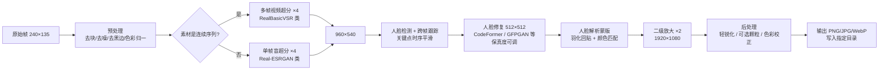

# 低清人物图像序列修复与循环播放工具 — 产品需求文档（PRD）

| 项目 | 内容 |
| --- | --- |
| 文档版本 | v0.1（初稿，待评审） |
| 日期 | 2026-11-01 |
| 产品代号 | **ReFrame**（暂定） |
| 状态 | 草案 / 进入 M0 技术验证前 |

---

## 0. 一页纸摘要（TL;DR）

- **要解决的问题**：手上有一批从老式手机视频中抽出的帧，分辨率只有 **240×135**，模糊、有压缩块、有噪点，主体是**人物**。希望在**本地**把它们批量修复成**高清**图，并能**挑选/整夹循环播放**查看效果。
- **核心判断（最重要的三句话）**：
  1. 这不是"单张图片放大"问题，而是**"视频序列修复"问题**。这些帧来自同一段视频，相邻帧互相包含亚像素信息，**利用多帧做超分能真正"找回"细节**；而且逐帧独立修复在循环播放时会**闪烁、人脸"变脸"**——这是本产品最大的隐性坑。
  2. 240×135 的画面里，人脸往往只有 **15～40 像素高**，修复出的五官细节有相当一部分是 AI **"合理生成"的**，而不是还原的。产品必须把**"像本人"（身份保真）**放在**"看起来清晰"**之前，并把这个权衡交给用户一个滑块来控制。
  3. 240×135 **×8 正好等于 1920×1080**。默认输出目标定为 1080p，分两级放大（×4 + ×2），中间插入人脸修复，效果和速度都最好。
- **形态**：Windows 优先的本地桌面应用（Python + PySide6 + PyTorch/ONNX Runtime），NVIDIA 显卡加速，原图**只读不改**，输出到用户指定目录，自带 A/B 对比预览和循环播放器。
- **第一步不是写 UI**：先用用户的真实素材做 1～2 周的**模型选型验证（M0）**，确定修复管线后再进入产品开发。

---

## 1. 背景与目标

### 1.1 背景

| 素材特征 | 对修复的影响 |
| --- | --- |
| 分辨率 240×135（16:9） | 信息量极低，单帧最多可信放大约 ×2～×4，更高倍率依赖生成 |
| 老式手机拍摄 | 镜头软、对焦不准、低光噪点大、白平衡偏色、动态范围窄 |
| 视频编码（3GP/H.263/早期 H.264 等） | 8×8 / 16×16 块效应、振铃、色度下采样（颜色"糊"、边缘渗色） |
| 从视频中抽帧 | 若抽成 JPG 又多了一次有损压缩；相邻帧高度相关（**可利用**） |
| 主体是人物 | 人眼对人脸极度敏感：五官稍有错位就"不像本人"或"恐怖谷" |

### 1.2 产品目标

| 编号 | 目标 | 衡量方式 |
| --- | --- | --- |
| G1 | 人物（尤其人脸）修复后**清晰且像本人** | 盲测偏好率 ≥ 80%；身份相似度见 §7 |
| G2 | 序列播放**稳定不闪烁** | 时序闪烁指标、主观评审无明显"跳脸" |
| G3 | 批量处理**安全**：原图零修改、可中断可续跑 | 原图哈希校验 100% 不变；断点续跑可用 |
| G4 | 本地离线运行，速度可接受 | 标准模式在 RTX 3060 级显卡上 ≥ 3 帧/秒（目标值，M0 验证） |
| G5 | 播放预览顺手 | 1080p 序列 30fps 流畅循环，不掉帧 |

### 1.3 非目标（v1 不做）

- 云端处理、账号体系、在线分享。
- 通用图片编辑（裁剪、滤镜、美颜等）。
- 直接导入视频文件解码（列入 v1.1，见 §9）。
- 为风景/文字/动漫专门优化（主攻真人）。

---

## 2. 用户与使用场景

**目标用户**：持有家庭老视频、旧手机录像的个人用户；以及需要整理老素材的视频创作者。电脑配置中等偏上（有独立显卡更佳），不懂深度学习参数。

**核心场景**

1. **批量修复**：打开一个含数百～数千帧的文件夹 → 选预设 → 先"试修一张"看效果 → 满意后整夹批量 → 输出到另一个文件夹，原图不动。
2. **挑选对比**：在缩略图里挑出几张关键帧 → 原图/修复图左右或滑杆对比 → 调整人脸修复强度 → 只重跑这几张。
3. **循环播放**：选择整个输出文件夹（或手选几张、或保存的播放列表）→ 设定帧率 → 循环/往返播放 → 可原图与修复图同步并排播放。

---

## 3. 核心技术方案：修复管线（产品的心脏）

### 3.1 设计原则

1. **多帧优先于单帧**：素材是连续帧时，优先用视频超分模型（利用相邻帧的真实信息），而不是让单帧模型"脑补"。
2. **保真优先于锐利**：宁可略软，不要"换脸"。人脸修复强度可调，默认偏保真。
3. **分级放大**：不一步 ×8。先 ×4 到 960×540（这一步信息最"真"），在此尺度做人脸修复，再 ×2 到 1920×1080。
4. **人脸与背景分治**：背景走通用超分，人脸走专用人脸修复，再用柔和蒙版融合。
5. **可复现**：所有参数、模型版本、随机种子写入任务清单，同样输入同样输出。

### 3.2 管线总览



### 3.3 各阶段说明与候选模型

> 下表为**候选**，最终组合由 M0 在用户真实素材上评测决定。许可证信息需在 M0 阶段逐一复核（见 §3.6）。

| 阶段 | 作用 | 候选方案 | 备注 |
| --- | --- | --- | --- |
| ① 预处理 | 去压缩块、去噪、去黑边、检测隔行 | SCUNet、FBCNN；OpenCV 黑边检测 | 强度可调；很多盲超分模型已内含去块能力，此步默认"轻" |
| ②a 多帧超分 ×4 | 利用相邻帧亚像素信息恢复真实细节 | RealBasicVSR、BasicVSR++、RVRT | **序列模式默认**；需按镜头切分，避免跨镜头"借"错信息 |
| ②b 单帧超分 ×4 | 散图/非连续帧 | Real-ESRGAN x4plus、HAT-Real、DAT、SwinIR-Real | 单张模式默认 |
| ③ 人脸检测/跟踪 | 在 ×4 后的图上找脸（原图上太小，检测会漏） | RetinaFace、YOLOv8-face；跨帧 IoU/关键点跟踪 | 关键点做时序滤波，避免对齐抖动导致"脸在晃" |
| ④ 人脸修复 | 生成清晰五官 | CodeFormer（保真度 w 可调）、GFPGAN v1.4、RestoreFormer++；视频人脸：KEEP、PGTFormer 等 | **产品核心卖点**，用户界面暴露"保真 ↔ 清晰"滑块 |
| ⑤ 融合 | 把修复后的脸贴回 | BiSeNet 人脸解析蒙版 + 羽化 + 直方图/均值方差颜色匹配 | 消除"脸和脖子两个颜色"、贴图硬边 |
| ⑥ 二级放大 ×2 | 960×540 → 1920×1080 | Real-ESRGAN x2 / 轻量 SR；或 Lanczos + 自适应锐化 | 速度敏感，可选轻量方案 |
| ⑦ 后处理 | 观感调优 | 轻 USM 锐化、可选胶片颗粒、自动白平衡 | 加少量颗粒可明显削弱"塑料感/磨皮感" |
| ⑧ 极致模式（可选） | 最高画质 | 扩散模型超分：SUPIR、DiffBIR、StableSR 类 | 显存需求高（常需 12～24GB）、慢（秒级～数十秒/帧）、幻觉与闪烁风险最大；仅作可选高级项 |

### 3.4 预设（面向普通用户，隐藏技术细节）

| 预设 | 管线 | 适用 | 速度（相对） |
| --- | --- | --- | --- |
| 快速 | 单帧 Real-ESRGAN ×4 + GFPGAN + Lanczos ×2 | 先看大致效果 | 最快 |
| **标准（默认）** | 序列：多帧超分 ×4 + CodeFormer(w≈0.6) + 时序平滑 + SR ×2 | 绝大多数场景 | 中 |
| 高质量 | 标准 + 预处理去块去噪 + 更大模型 + 更强融合 | 精选关键帧、成品输出 | 慢 |
| 极致（实验） | 扩散模型超分 + 人脸修复 | 少量海报级单帧 | 很慢 |

**高级参数**（折叠面板）：放大倍率（×2 / ×4 / ×8 / 指定目标分辨率）、去噪强度、人脸修复强度（保真度）、是否只修人脸/只修背景、是否启用序列模式、分块（tile）大小、输出格式与质量。

### 3.5 关键难点与对策

| 难点 | 表现 | 对策 |
| --- | --- | --- |
| **身份漂移（"不像本人"）** | 眼型、鼻型、年龄感被模型改写 | 默认偏保真的 w 值；提供保真滑块；ArcFace 身份相似度自动检查，低于阈值的帧标黄提示；可切换"仅轻度修复" |
| **时序闪烁** | 循环播放时五官、纹理逐帧跳动 | 多帧超分；人脸关键点时序平滑；固定随机种子；可选视频人脸修复模型；输出后做闪烁指标检测 |
| **小脸检测不到** | 远景人物脸未被修复 | 在 ×4 尺度检测；降低阈值 + 跨帧跟踪补漏；脸过小（<约 16px 原尺寸）时降低修复强度，避免"贴一张假脸" |
| **塑料感 / 磨皮感** | 皮肤过度平滑、像蜡像 | 人脸修复与原始 SR 结果按比例混合；后处理加细颗粒 |
| **贴图痕迹** | 脸部边缘硬、肤色不一致 | 解析蒙版 + 羽化 + 颜色匹配 |
| **镜头切换** | 多帧模型跨镜头"借"错信息、产生鬼影 | 自动镜头切分（帧差/直方图），在镜头边界重置 |
| **显存不足** | 大模型 OOM | 自动分块推理（tile + overlap），FP16，自动降级 |

### 3.6 许可证风险（必须在 M0 定论）

开源人脸/超分模型的许可证差异很大，**部分常用模型仅限非商业用途**（例如 CodeFormer 采用 S-Lab License，SUPIR 也有非商用限制）；Real-ESRGAN、GFPGAN、facexlib 等采用较宽松的许可证，但其依赖和预训练权重也需逐项确认。

- 若产品**仅自用/非商用**：可自由选用效果最好的组合。
- 若**未来有商业化打算**：需在 M0 产出"模型许可证清单"，并准备可商用的替代组合（如 GFPGAN 路线）。

---

## 4. 功能需求

优先级：**P0** = MVP 必须；**P1** = v1.0 应有；**P2** = 后续版本。

### 4.1 导入与素材管理

| ID | 需求 | 优先级 |
| --- | --- | --- |
| F-IN-01 | 打开单个/多个图片文件，打开整个文件夹（可选递归子目录） | P0 |
| F-IN-02 | 拖拽文件/文件夹到窗口导入 | P0 |
| F-IN-03 | 支持 JPG / PNG / BMP / WebP / TIFF | P0 |
| F-IN-04 | **自然排序**（frame_2 排在 frame_10 之前），可切换按修改时间排序 | P0 |
| F-IN-05 | 缩略图网格 + 列表视图；显示分辨率、文件大小、处理状态（未处理/已处理/失败） | P0 |
| F-IN-06 | 多选（Ctrl/Shift）、全选、反选、按状态筛选 | P0 |
| F-IN-07 | 自动识别"连续序列"（文件名序号连续 + 尺寸一致），提示启用序列模式 | P1 |
| F-IN-08 | 自动镜头切分并在缩略图中标记镜头边界 | P1 |

### 4.2 修复处理

| ID | 需求 | 优先级 |
| --- | --- | --- |
| F-PR-01 | 预设选择（快速/标准/高质量），高级参数折叠面板 | P0 |
| F-PR-02 | **试修**：对当前选中的 1～3 张立即出结果，供确认参数 | P0 |
| F-PR-03 | 批量处理：选中项 / 整个文件夹 | P0 |
| F-PR-04 | 输出目录由用户指定，记住上次选择 | P0 |
| F-PR-05 | 输出命名模板，默认 `{原文件名}_x8.png`；支持 `{name}` `{index}` `{scale}` `{preset}` | P0 |
| F-PR-06 | 输出格式：PNG（默认，无损）/ JPG（质量可调）/ WebP | P0 |
| F-PR-07 | 任务队列：进度条、当前帧、已用时间、预计剩余时间 | P0 |
| F-PR-08 | 暂停 / 继续 / 取消；单帧失败不影响整批，失败列表可一键重试 | P0 |
| F-PR-09 | **断点续跑**：程序崩溃或关闭后，重开可跳过已完成帧继续 | P0 |
| F-PR-10 | 同名冲突策略：跳过 / 自动重命名 / 覆盖（仅限输出目录内的旧输出） | P0 |
| F-PR-11 | 人脸修复强度滑块（保真 ↔ 清晰），实时预览 | P0 |
| F-PR-12 | 序列模式开关（多帧超分 + 时序平滑） | P1 |
| F-PR-13 | 身份相似度/闪烁自动质检，异常帧标黄 | P1 |
| F-PR-14 | 每次任务生成 `manifest.json`（参数、模型及版本、种子、源文件哈希、耗时） | P1 |
| F-PR-15 | 输出同时保存"仅超分未修脸"版本（便于对比/混合） | P2 |
| F-PR-16 | 极致模式（扩散模型） | P2 |

### 4.3 对比预览

| ID | 需求 | 优先级 |
| --- | --- | --- |
| F-CP-01 | 原图 / 修复图 **滑杆对比**（左右拖动分割线） | P0 |
| F-CP-02 | 并排对比、快速切换对比（按住空格看原图） | P0 |
| F-CP-03 | 缩放（适应窗口 / 1:1 / 200%），两侧缩放与平移同步 | P0 |
| F-CP-04 | 原图显示时使用"最近邻"与"双三次"两种放大方式可切换（便于看清原始信息量） | P1 |

### 4.4 播放器

| ID | 需求 | 优先级 |
| --- | --- | --- |
| F-PL-01 | 播放源：手动选中的若干张 / 整个文件夹 / 播放列表 | P0 |
| F-PL-02 | 播放控制：播放/暂停、上一帧/下一帧、进度条拖动、跳到首尾 | P0 |
| F-PL-03 | 帧率可调 1～60 fps（默认 = 原视频常见值 15 / 25 / 30 可选），或按"每张停留 N 秒"幻灯片模式 | P0 |
| F-PL-04 | 循环模式：单次 / **循环** / **往返（乒乓）** / 区间循环（A-B） | P0 |
| F-PL-05 | 全屏播放；画面适应 / 1:1 / 填充 | P0 |
| F-PL-06 | 快捷键：空格 播放暂停，← → 逐帧，F 全屏，Esc 退出全屏，[ ] 调速 | P0 |
| F-PL-07 | **同步对比播放**：原图序列与修复序列左右并排同步播放 | P1 |
| F-PL-08 | 播放列表保存/加载（`.reframe-playlist.json`，存相对路径） | P1 |
| F-PL-09 | 随机播放、倒序播放 | P2 |
| F-PL-10 | 导出为 MP4 / GIF（调用 FFmpeg） | P2 |

### 4.5 设置

| ID | 需求 | 优先级 |
| --- | --- | --- |
| F-ST-01 | 计算设备选择（自动 / 指定 GPU / CPU），显示显存 | P0 |
| F-ST-02 | 模型管理：首次运行下载模型（显示进度、SHA256 校验、断点续传），支持离线导入模型包 | P0 |
| F-ST-03 | 性能选项：FP16、分块大小、并发数 | P1 |
| F-ST-04 | 界面语言（中文/英文）、主题（浅/深） | P2 |

---

## 5. 原图安全（硬性要求）

"不删除、不修改原始图片"是本产品的信任底线，按**机制保证**而不是靠"小心"：

1. 源文件**只以只读方式打开**，处理代码中不存在对源路径的写/删/重命名调用。
2. **输出路径校验**：解析真实路径后，若输出文件路径与任何源文件相同，直接拒绝；输出目录与源目录相同时弹出警告并强制使用不同文件名后缀。
3. **原子写入**：先写 `*.tmp`，完成后 `rename` 为正式文件，崩溃时不会留下半张坏图，也不会波及他处文件。
4. **测试保障**：自动化测试在批处理前后对源文件做 SHA256 比对，必须 100% 一致。

---

## 6. 非功能需求

| 类别 | 要求 |
| --- | --- |
| 隐私 | 全程离线处理，不上传任何图像；除模型下载外不联网（模型下载可关闭，改为手动导入） |
| 性能（目标，M0 校准） | 标准模式 RTX 3060 12GB：≥ 3 帧/秒；快速模式 ≥ 8 帧/秒；1000 帧标准模式 < 10 分钟 |
| 响应性 | 推理在独立进程中运行，处理期间 UI 不卡顿、可正常浏览和播放 |
| 播放 | 1080p PNG 序列 30fps 不掉帧（后台预解码 + 环形缓存） |
| 稳定性 | 连续处理 10,000 帧无内存泄漏；显存 OOM 自动降级分块，不崩溃 |
| 兼容 | Windows 10/11 x64 优先；NVIDIA（CUDA）主力；AMD/Intel 显卡走 DirectML 或 ncnn-Vulkan 降级方案；无显卡可用 CPU 但会提示很慢 |
| 安装 | 一键安装包；程序本体与模型分离，模型按需下载 |
| 可观测 | 本地日志（滚动文件），任务失败附带可导出的诊断信息 |

---

## 7. 质量评估体系

修复没有"标准答案"（不存在原始高清图），因此必须建立自己的评估方法，否则选模型只能凭感觉。

1. **黄金测试集**：从用户真实素材中挑 50～100 帧，覆盖：近景人脸、中景、远景小脸、侧脸、逆光/暗光、运动模糊、多人同框、镜头切换处。
2. **自动指标**
   - 无参考画质：MUSIQ、CLIP-IQA、NIQE（越清晰自然越好）。
   - **身份保真**：ArcFace 计算"修复结果"与"原图双三次放大"的人脸特征相似度（防止换脸）。
   - **身份一致性**：同一人物在相邻帧间的特征相似度（防止跳脸）。
   - **时序稳定**：光流对齐后的帧间误差（Warping Error），衡量闪烁。
3. **主观评审**：原图 vs 各方案的双盲 A/B 测试，打分维度：清晰度、像本人、自然度、播放稳定性。
4. **验收线**（M0 后定稿）：标准模式在黄金集上主观偏好率 ≥ 80%，无明显"换脸"案例，循环播放无可察觉闪烁。

---

## 8. 技术架构

### 8.1 技术选型

| 层 | 选型 | 理由 |
| --- | --- | --- |
| GUI | **PySide6（Qt 6）** | 原生桌面性能好，图片/播放控件成熟，与推理代码同语言，避免 Electron + Python 双栈的打包复杂度 |
| 推理 | 开发期 **PyTorch**；发布期优先 **ONNX Runtime**（CUDA / DirectML），性能关键模型可选 TensorRT | 兼顾开发效率与分发体积、显卡兼容 |
| 图像 IO | OpenCV / Pillow | 成熟稳定 |
| 并发 | 推理放独立子进程（multiprocessing / QProcess），通过队列回传进度 | 推理崩溃不拖垮界面；可随时取消 |
| 播放 | QOpenGLWidget 渲染 + 后台解码线程 + LRU 环形缓存 | 1080p 高帧率流畅 |
| 打包 | PyInstaller 或 Nuitka + Inno Setup | Windows 一键安装 |
| 配置 | 预设用 YAML 描述管线阶段与参数 | 新增/调整管线不改代码 |

### 8.2 模块划分

```text
reframe/
├── core/                  # 与界面无关的修复引擎（可单独以 CLI 运行，便于测试与批处理）
│   ├── pipeline.py        # 按预设组装各阶段
│   ├── stages/            # preprocess / sr_video / sr_image / face_detect / face_restore / blend / post
│   ├── models/            # 模型注册表、下载、校验、后端适配（torch / onnx）
│   ├── sequence.py        # 序列识别、镜头切分、跨帧跟踪
│   ├── qa.py              # 身份相似度、闪烁检测
│   └── io_safe.py         # 只读打开、路径校验、原子写入
├── worker/                # 推理子进程、任务队列、断点续跑（manifest）
├── app/                   # PySide6 界面
│   ├── library/           # 导入、缩略图、筛选
│   ├── compare/           # 滑杆/并排对比
│   ├── player/            # 播放器、播放列表
│   └── settings/
├── presets/               # fast.yaml / standard.yaml / quality.yaml
├── tests/                 # 单元测试 + 黄金集回归 + 原图哈希安全测试
└── cli.py                 # reframe restore <in> -o <out> --preset standard
```

**关键设计**：`core` 引擎与 GUI 完全解耦，先有 CLI。这样 M0 的模型评测、后续的回归测试、甚至高级用户的脚本批处理，都直接复用同一套引擎。

---

## 9. 版本规划与里程碑

| 阶段 | 周期（估） | 交付物 | 退出标准 |
| --- | --- | --- | --- |
| **M0 技术验证** | 1～2 周 | 黄金测试集；3～5 套候选管线在真实素材上的对比图、对比视频、指标表；许可证清单；性能实测 | 确定"标准预设"管线，主观偏好达标 |
| **M1 引擎 + CLI** | 2 周 | `core` 引擎、预设 YAML、CLI、原图安全机制、断点续跑 | CLI 可批量处理千帧，安全测试通过 |
| **M2 MVP 桌面版** | 3 周 | 导入、试修、批量队列、滑杆对比、基础播放器（循环/往返/调速/全屏） | 全部 P0 需求完成 |
| **M3 序列增强** | 2 周 | 序列模式、镜头切分、人脸跟踪平滑、自动质检、同步对比播放 | 循环播放无明显闪烁 |
| **M4 打包发布 v1.0** | 1～2 周 | 安装包、模型下载器、DirectML 降级、文档 | 在 3 种典型配置机器上验收通过 |
| v1.1 | — | 直接导入视频（FFmpeg 解码为无损 PNG）、导出 MP4/GIF、补帧（RIFE）让播放更顺滑 | — |
| v2.0 | — | 极致模式（扩散模型）、按人物指定参考照片做身份引导修复 | — |

---

## 10. 风险登记

| 风险 | 可能性 | 影响 | 应对 |
| --- | --- | --- | --- |
| 用户对"高清"期望过高（期待还原真实毛孔/文字） | 高 | 高 | 产品内用对比示例坦诚说明"细节为 AI 合成"；默认保真优先 |
| 人脸修复导致"不像本人" | 中 | 高 | 保真滑块、身份相似度质检、可回退到仅超分版本 |
| 序列闪烁 | 高 | 高 | 多帧超分 + 时序平滑，列为 M3 核心目标 |
| 模型许可证限制商用 | 中 | 高 | M0 出许可证清单，准备可商用替代组合 |
| 安装包体积大（PyTorch + CUDA 可达数 GB） | 高 | 中 | 发布期转 ONNX Runtime；模型按需下载 |
| 用户无 NVIDIA 显卡 | 中 | 中 | DirectML / ncnn-Vulkan 降级；CPU 模式明确提示耗时 |
| 抽帧已是 JPG 二次压缩 | 中 | 中 | 建议用户从原视频重新抽无损 PNG（v1.1 内置） |

---

## 11. 待确认问题（需要你拍板）

1. **运行平台**：只做 Windows，还是也要 macOS（Apple 芯片需走 CoreML/MPS，模型选择会受限）？
2. **显卡配置**：你自己用的机器是什么显卡、多少显存？这决定默认预设和是否值得做极致模式。
3. **用途**：仅个人/家庭自用，还是将来可能商用分发？（直接决定能否用 CodeFormer 等非商用模型）
4. **原视频是否还在**？如果在，强烈建议直接从视频以无损 PNG 抽帧（甚至直接处理视频），质量会比处理已有 JPG 帧更好。
5. **素材规模**：大概多少段视频、总共多少帧？
6. **输出目标**：1080p 是否足够？还是需要 4K（×16，基本全靠生成，不建议默认）？
7. **播放需求**：是否需要把修复后的序列导出成视频分享？
